## ShopBondhu AWS Assignment — Launch Day Infrastructure

A custom AWS VPC hosts the ShopBondhu static HTML/CSS/JavaScript landing page on an internet-facing Ubuntu EC2 instance with Nginx. A second Ubuntu EC2 instance sits in a private subnet and uses a public NAT Gateway for outbound software updates without direct internet exposure.


# Architecture Diagram

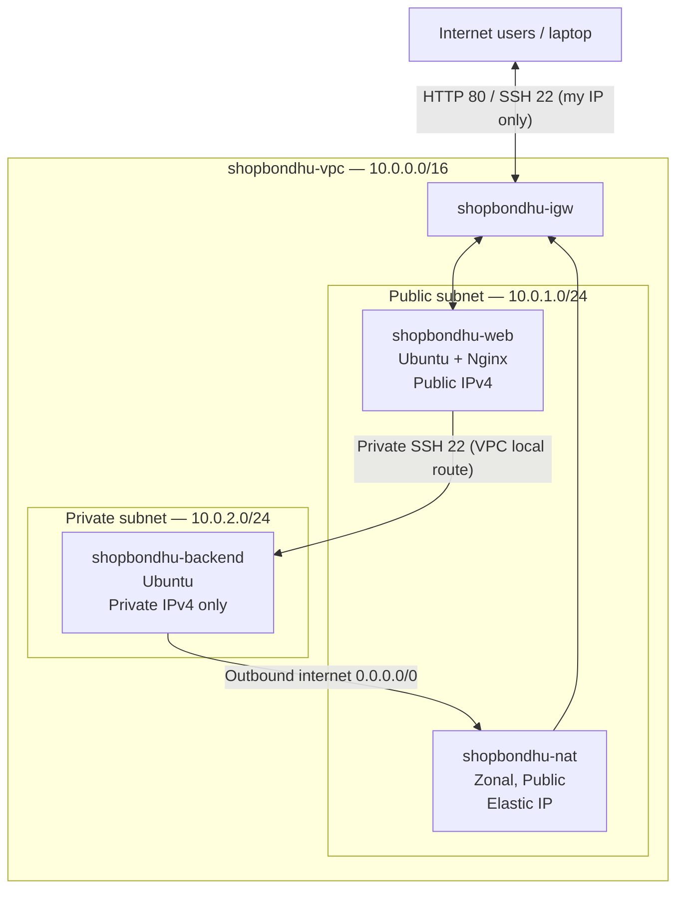

**Internet-facing path:** Internet → Internet Gateway → public EC2 / Nginx (HTTP).  
**Backend update path:** private EC2 → NAT Gateway (in public subnet) → Internet Gateway → internet.  
**Administrative path:** laptop → public EC2 (bastion) → private EC2 over private IP; the backend accepts SSH only from the public EC2 security group.

# Resources Created

| Resource | Name | CIDR/ID | Notes |
|---|---|---|---|
| AWS Region | REPLACE_ME | e.g. ap-southeast-1 | Same Region for all resources |
| VPC | shopbondhu-vpc | 10.0.0.0/16; `vpc-042019d9cee04ad57` | Custom VPC; not default |
| Public subnet | shopbondhu-public-subnet | 10.0.1.0/24; `subnet-01b789642b680da75` | Auto-assign public IPv4 on |
| Private subnet | shopbondhu-private-subnet | 10.0.2.0/24; `subnet-0a10dd9915f94b5b1` | No auto-assign public IP |
| Internet Gateway | shopbondhu-igw | `igw-05caecc3eba27d4f9` | Attached to custom VPC |
| NAT Gateway | shopbondhu-nat | `nat-0bd2eb0651bd7f771` | Zonal/Public, inside public subnet |
| Elastic IP | shopbondhu-nat-eip | `eipalloc-037a6a15f7ee79cee` | Connected to NAT Gateway, later released |
| Public route table | shopbondhu-public-rt | `rtb-0152d018190331102` | Default IPv4 route to IGW |
| Private route table | shopbondhu-private-rt | `rtb-00252ac412366ed28` | Default IPv4 route to NAT |
| Public EC2 | shopbondhu-web | `i-0e906b869f0a0dfa1` | Ubuntu; public IP `13.201.86.168` |
| Private EC2 | shopbondhu-backend | `i-0d4d204bdc9bd8c36` | Ubuntu; private IP `10.0.2.93` |
| Web security group | shopbondhu-web-sg | `sg-022abf3062bcbbc0d` | TCP 22 from own IP/32, TCP 80 from 0.0.0.0/0 |
| Backend security group | shopbondhu-backend-sg | `sg-0a98d95a0f87c89a0` | TCP 22 from shopbondhu-web-sg only |

# Step-by-Step Setup

## Task 1: Create the VPC

AWS Console → VPC → Your VPCs → Create VPC → **VPC only**. Set Name `shopbondhu-vpc`, IPv4 CIDR `10.0.0.0/16`, and keep tenancy Default. Enable DNS resolution and DNS hostnames in VPC Actions → Edit VPC settings if needed.

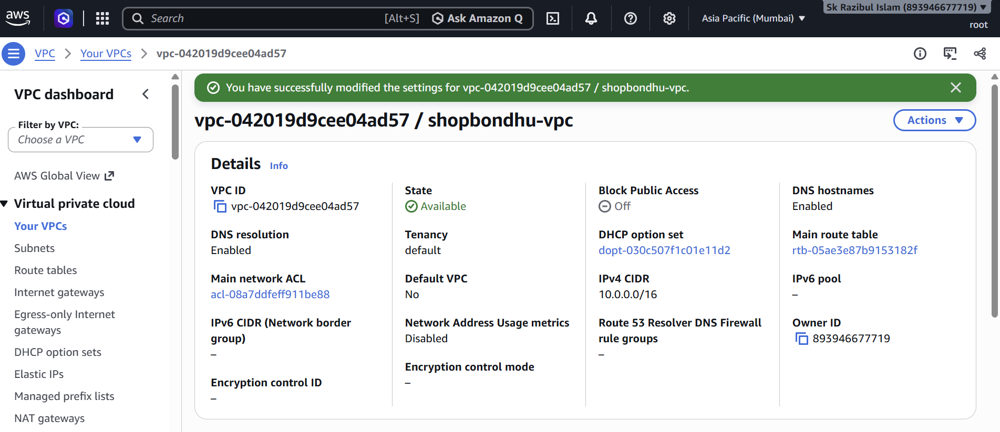

## Task 2: Create the public and private subnets

VPC → Subnets → Create subnet. Select `shopbondhu-vpc` and create `shopbondhu-public-subnet` with `10.0.1.0/24` and `shopbondhu-private-subnet` with `10.0.2.0/24`, in the same Availability Zone for the lab. After creation, Public subnet → Actions → Edit subnet settings → Enable auto-assign public IPv4. Keep the private subnet auto-assign setting disabled.

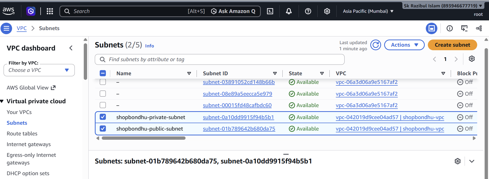

## Task 3: Create and attach the Internet Gateway

VPC → Internet Gateways → Create Internet Gateway, name `shopbondhu-igw`. Select it → Actions → Attach to VPC → `shopbondhu-vpc`.

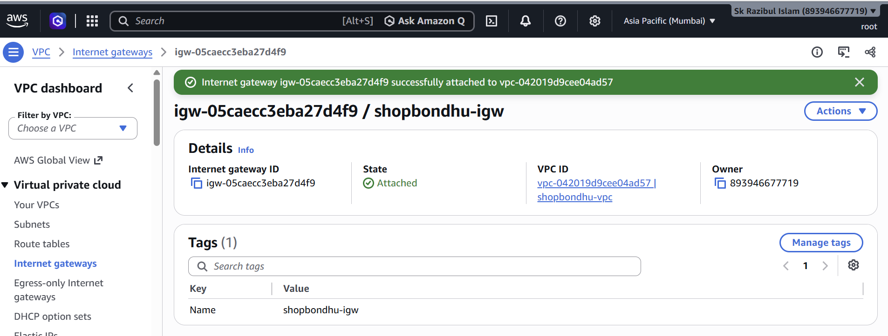

## Task 4: Create NAT Gateway and Elastic IP

VPC → Elastic IP addresses → Allocate Elastic IP address, tag as `shopbondhu-nat-eip`. VPC → NAT Gateways → Create NAT Gateway. Set Name `shopbondhu-nat`, Availability Mode **Zonal**, Subnet `shopbondhu-public-subnet`, Connectivity **Public**, and choose the allocated Elastic IP. Check NAT Gateway state **Available**.

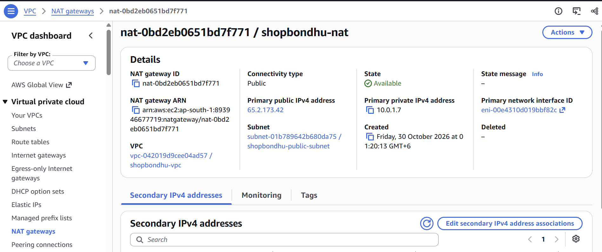

## Task 5: Configure route tables

Create `shopbondhu-public-rt` in the custom VPC and add a default route `0.0.0.0/0 → shopbondhu-igw`, retaining `10.0.0.0/16 → local`. Associate this route table explicitly with `shopbondhu-public-subnet`.

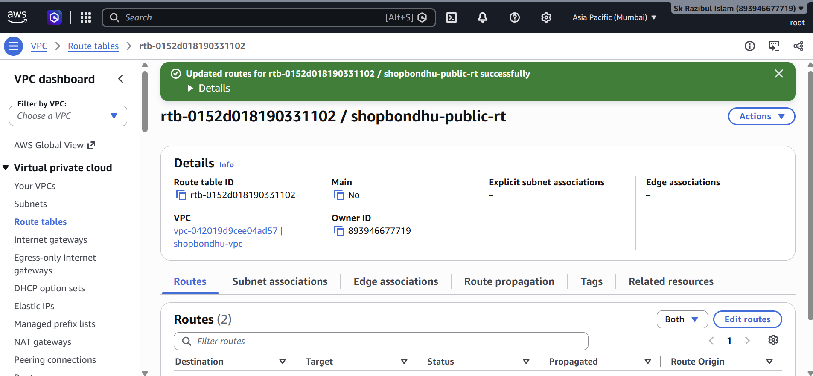

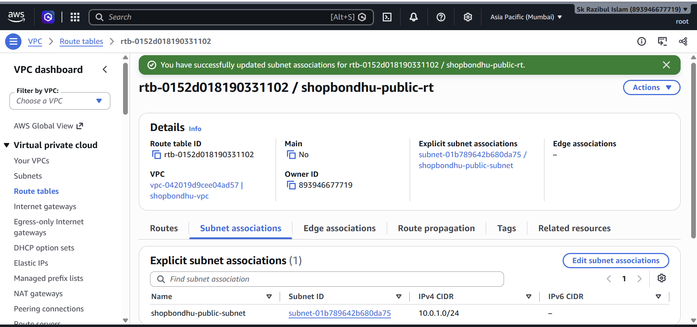

Create `shopbondhu-private-rt` in the custom VPC and add `0.0.0.0/0 → shopbondhu-nat`, retaining `10.0.0.0/16 → local`. Associate it explicitly with `shopbondhu-private-subnet`.

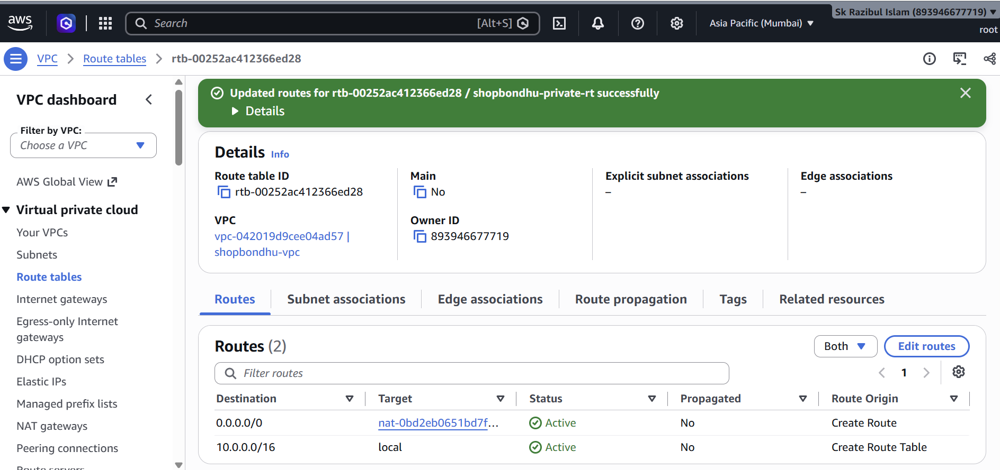

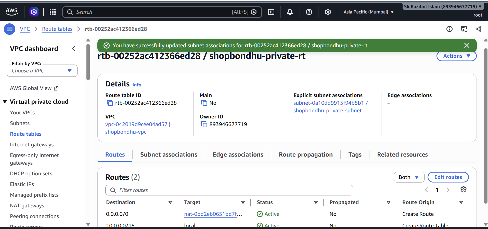

## Task 6: Launch Ubuntu EC2 instances and security groups

Create one SSH key pair for both instances; **keep its PEM file locally, outside this repository**. Create `shopbondhu-web-sg` allowing SSH TCP 22 only from **My IP** and HTTP TCP 80 from `0.0.0.0/0`. Create `shopbondhu-backend-sg` allowing SSH TCP 22 only from the security group **shopbondhu-web-sg**. Both groups should allow necessary outbound traffic (the default outbound-all rule is adequate for this lab).

Launch `shopbondhu-web` with Ubuntu, t2.micro/t3.micro (subject to availability), custom VPC, **public subnet**, public IPv4 **Enable**, key pair, and web SG. Launch `shopbondhu-backend` with Ubuntu, same VPC, **private subnet**, public IPv4 **Disable**, same key pair, and backend SG.


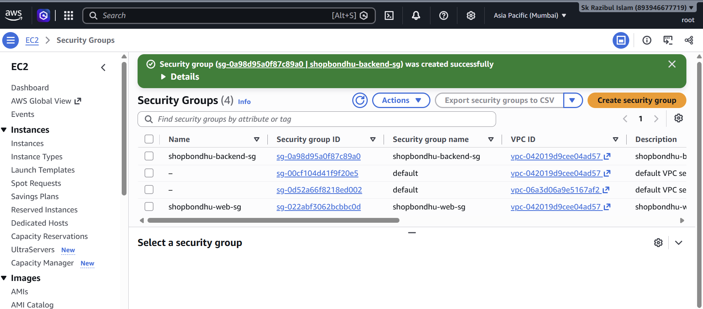

# Nginx & Frontend Deployment

## Task 7: Install and verify Nginx on public EC2

From a PowerShell terminal on Windows:

```powershell
ssh -i "$HOME\.ssh\shopbondhu-key.pem" ubuntu@13.201.86.168
```

On `shopbondhu-web` (Ubuntu shell):

```bash
sudo apt update
sudo apt install -y nginx curl
sudo systemctl start nginx
sudo systemctl enable nginx
sudo nginx -t
sudo systemctl status nginx --no-pager
curl -I http://localhost
```

Browse to `http://13.201.86.168` and confirm the **default Nginx welcome page** appears.

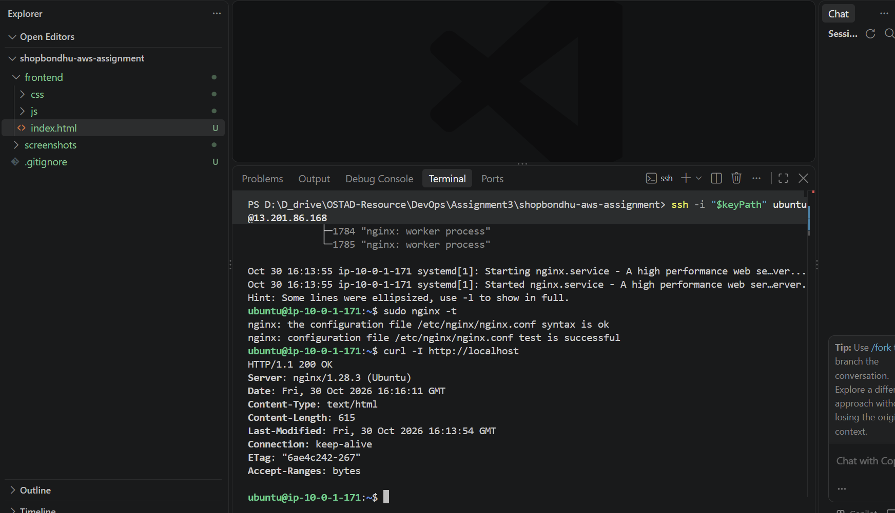

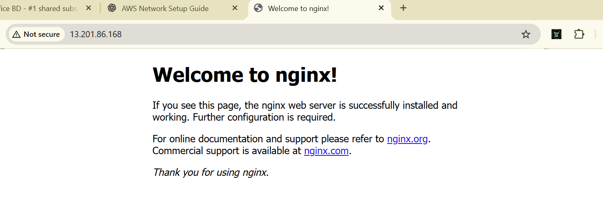

## Task 8: Deploy ShopBondhu static frontend

On Windows laptop, in the **repository root**, run:

```powershell
scp -i "$HOME\.ssh\shopbondhu-key.pem" -r .\frontend ubuntu@13.201.86.168:/home/ubuntu/shopbondhu-frontend
```

Return to the **Ubuntu shell on shopbondhu-web**:

```bash
sudo rm -f /var/www/html/index.nginx-debian.html
sudo cp -a /home/ubuntu/shopbondhu-frontend/. /var/www/html/
sudo nginx -t
sudo systemctl reload nginx
ls -lah /var/www/html
curl -I http://localhost
```

Browse to `http://13.201.86.168`. The ShopBondhu landing page must load. The address bar should show the public IP. Static resources live under `/var/www/html/css/` and `/var/www/html/js/`.

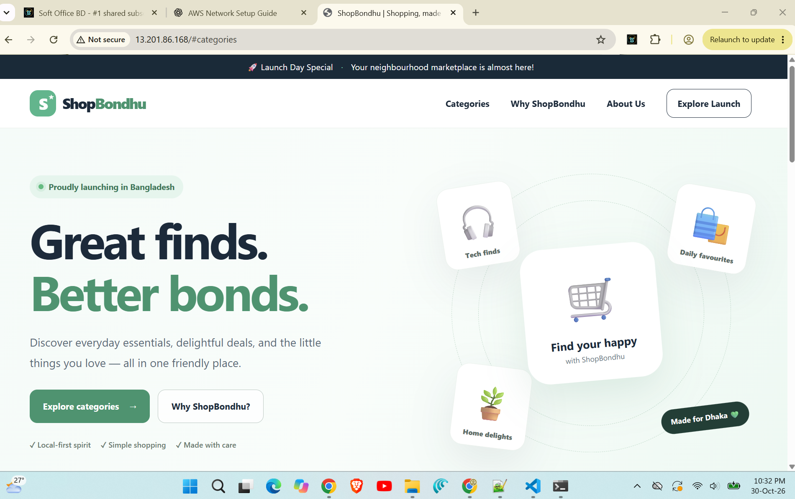

# NAT Gateway Test

## Task 9: Access the private EC2 through the public EC2 bastion

```powershell
Set-Service ssh-agent -StartupType Manual
Start-Service ssh-agent
ssh-add "$HOME\.ssh\shopbondhu-key.pem"
ssh -i "$HOME\.ssh\shopbondhu-key.pem" -J ubuntu@13.201.86.168 ubuntu@10.0.2.93
```

With `-J`, the explicit `-i` is primarily applied to the destination, so loading the key into the local SSH agent also allows authentication to the jump host. This authenticates to the backend through the public EC2 without placing the private key on the bastion. If both instances use the same EC2 key pair, you may instead use **temporary SSH agent forwarding** and, while logged into the public EC2, run `ssh ubuntu@10.0.2.93`. 

On `shopbondhu-backend`:

```bash
hostname
hostname -I
sudo apt update
curl -I https://www.google.com
curl -4 https://checkip.amazonaws.com
```

The expected result is that Ubuntu package repositories and HTTPS requests respond successfully, while `checkip.amazonaws.com` shows the **NAT Elastic IP**. The last value must be verified against your actual Elastic IP, not assumed.

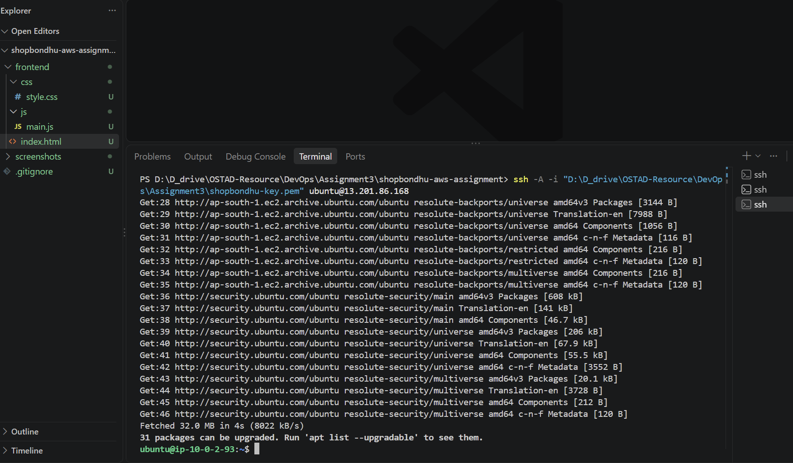

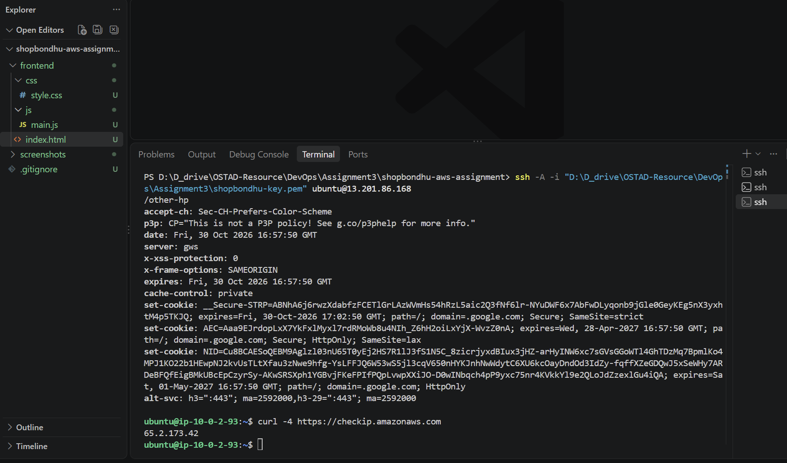

From the laptop, attempt SSH to the **private** IPv4 without a bastion or VPN:

```powershell
Test-NetConnection -ComputerName 10.0.2.93 -Port 22
```

The private server has no directly reachable public IPv4 address, its subnet has no route to an Internet Gateway for inbound internet traffic, and its security group authorizes SSH only from `shopbondhu-web-sg`. Thus direct access over the public internet does not work. A failed ping is less conclusive by itself because ICMP is also not allowed by the configured security group.

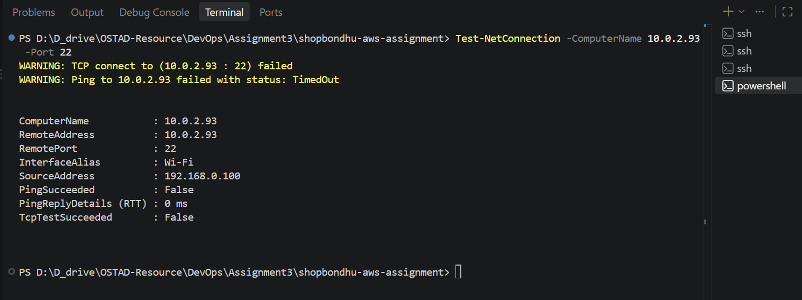

# Troubleshooting Answers

## Task 10 — Problem A: Website inaccessible although SSH works

1. **TCP port 80 is missing from the web security group.** In EC2 → Security Groups → `shopbondhu-web-sg` → Inbound rules, verify HTTP TCP 80 from `0.0.0.0/0`.
2. **Nginx is stopped, failed, or not listening.** On the web EC2 run `sudo systemctl status nginx --no-pager`, `sudo nginx -t`, `sudo ss -ltnp | grep ':80'`, and `curl -I http://localhost`. Start or fix Nginx if needed.
3. **Frontend files or Nginx document root are incorrect.** Run `ls -lah /var/www/html/` and check that `index.html`, `css/`, and `js/` are present. Inspect `sudo nginx -T` and `/var/log/nginx/error.log` if the server serves a different page or responds with errors.
4. **Wrong URL, public IPv4 address, or public routing.** Check the instance's current public IP in the EC2 details, try `http://13.201.86.168` (not HTTPS for this HTTP-only lab), and verify the public route table contains `0.0.0.0/0 → IGW` and is associated with the web subnet. Note that SSH working from the internet makes a totally missing IGW route less likely.
5. **Network ACL or OS firewall blocks port 80.** Inspect the subnet NACL for inbound TCP 80 and return traffic; if UFW is enabled, run `sudo ufw status` and verify HTTP is permitted.

## Task 10 — Problem B: `sudo apt update` on backend hangs or times out

1. **NAT Gateway is missing, unavailable, or in the wrong subnet.** In VPC → NAT Gateways, verify state `Available`, Connectivity `Public`, Availability Mode `Zonal`, and subnet `shopbondhu-public-subnet`. A NAT in the private subnet cannot provide the intended internet egress.
2. **Elastic IP is not associated with the public NAT Gateway.** Check the NAT Gateway Details and Elastic IP Allocation ID. A Zonal public NAT requires a public EIP for internet traffic.
3. **Private route table has no correct default route or association.** Verify the backend's subnet is associated with `shopbondhu-private-rt` and that `0.0.0.0/0` targets `shopbondhu-nat` in active state, in addition to the VPC-local route.
4. **NAT public subnet does not route to IGW.** Verify `shopbondhu-public-rt` is associated with the NAT subnet, and has `0.0.0.0/0 → shopbondhu-igw` with the IGW attached to the VPC.
5. **Outbound SG/NACL or DNS blocks traffic.** Check backend outbound TCP 80 and 443 and DNS, subnet NACL return traffic rules, and VPC DNS resolution. Run `getent hosts archive.ubuntu.com`, `curl -I https://www.google.com`, and `curl -4 https://checkip.amazonaws.com` to distinguish name-resolution from connection problems.


# Cleanup

**Complete all verification and evidence captures before this step.** NAT Gateway incurs hourly and data processing charges; public IPv4 addresses also have charges. Deleting NAT Gateway **does not** automatically release its EIP.

1. VPC → NAT Gateways → `shopbondhu-nat` → Actions → Delete NAT Gateway → confirm. Capture proof after its state becomes **Deleted**.
2. VPC / EC2 → Elastic IP addresses → select the former NAT EIP → Actions → Release Elastic IP address. Capture the post-release Elastic IP list (or an allocation-ID filter with no match).
3. The private route `0.0.0.0/0 → NAT` may become a **blackhole**. Remove or update it after documenting the functional NAT test; after NAT deletion, private outbound internet access no longer works.
4. When the whole assignment is finished and its site need not remain available, terminate both EC2 instances and remove other unused resources to avoid further charges. Keep your screenshots and repository history as evidence.

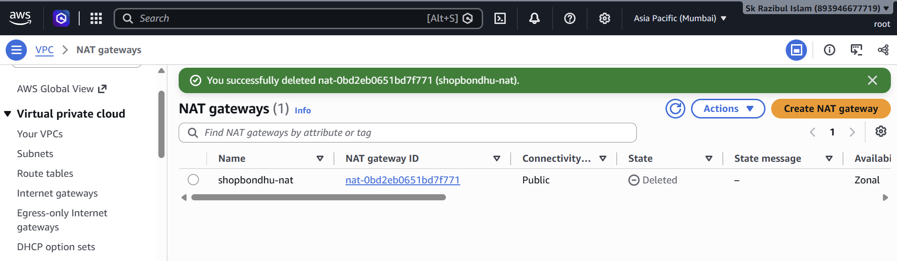

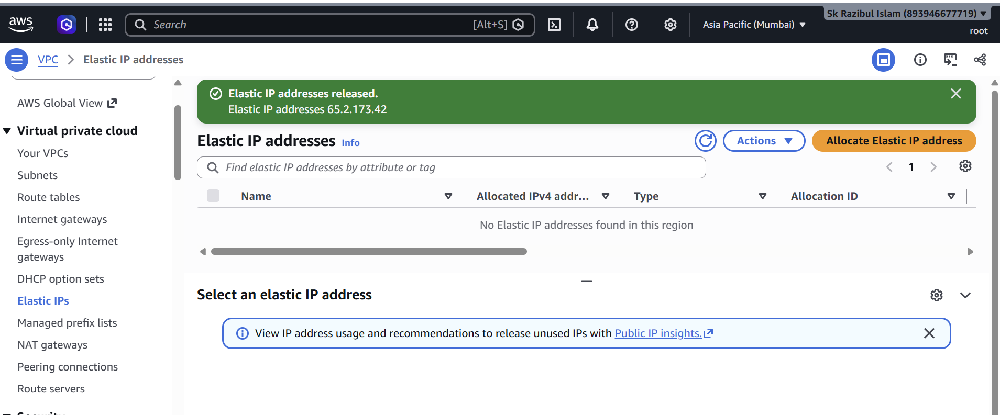

**Cleanup performed on:** `Friday, 30 October 2026 at 23:09:39 GMT+6`  
**NAT Gateway final status:** `Deleted`  
**Former Elastic IP allocation ID:** `eipalloc-037a6a15f7ee79cee`  
**Elastic IP released:** `released`

# What I Learned

- A custom VPC lets me control the address space, subnet boundaries, and traffic routes instead of using AWS default networking.
- A public subnet needs an IGW route, and its EC2 instance also needs a public IP and the correct security-group rules to serve internet users.
- A NAT Gateway permits outbound package updates from a private instance without exposing that instance to unsolicited connections from the internet.
- Referring to the web security group in the backend security group is more maintainable than allowing SSH from every source.
- Keeping screenshots, terminal commands, Git history, and cleanup evidence makes an infrastructure assignment reproducible and auditable.
