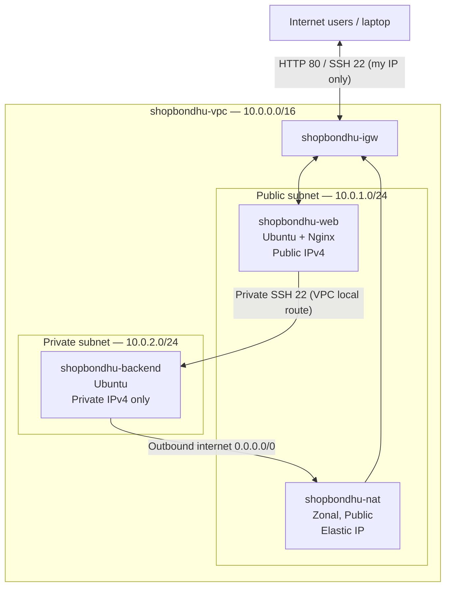

## ShopBondhu AWS Assignment — Launch Day Infrastructure

A custom AWS VPC hosts the ShopBondhu static HTML/CSS/JavaScript landing page on an internet-facing Ubuntu EC2 instance with Nginx. A second Ubuntu EC2 instance sits in a private subnet and uses a public NAT Gateway for outbound software updates without direct internet exposure.

# Architecture Diagram

**Internet-facing path:** Internet → Internet Gateway → public EC2 / Nginx (HTTP).  
**Backend update path:** private EC2 → NAT Gateway (in public subnet) → Internet Gateway → internet.  
**Administrative path:** laptop → public EC2 (bastion) → private EC2 over private IP; the backend accepts SSH only from the public EC2 security group.

# Resources Created

| Resource | Name | CIDR/ID | Notes |
|---|---|---|---|
| AWS Region | REPLACE_ME | e.g. ap-southeast-1 | Same Region for all resources |
| VPC | shopbondhu-vpc | 10.0.0.0/16; `vpc-042019d9cee04ad57` | Custom VPC; not default |
| Public subnet | shopbondhu-public-subnet | 10.0.1.0/24; `subnet-01b789642b680da75` | Auto-assign public IPv4 on |
| Private subnet | shopbondhu-private-subnet | 10.0.2.0/24; `subnet-0a10dd9915f94b5b1` | No auto-assign public IP |
| Internet Gateway | shopbondhu-igw | `igw-05caecc3eba27d4f9` | Attached to custom VPC |
| NAT Gateway | shopbondhu-nat | `nat-0bd2eb0651bd7f771` | Zonal/Public, inside public subnet |
| Elastic IP | shopbondhu-nat-eip | `eipalloc-037a6a15f7ee79cee` | Connected to NAT Gateway, later released |
| Public route table | shopbondhu-public-rt | `rtb-0152d018190331102` | Default IPv4 route to IGW |
| Private route table | shopbondhu-private-rt | `rtb-00252ac412366ed28` | Default IPv4 route to NAT |
| Public EC2 | shopbondhu-web | `i-0e906b869f0a0dfa1` | Ubuntu; public IP `13.201.86.168` |
| Private EC2 | shopbondhu-backend | `i-0d4d204bdc9bd8c36` | Ubuntu; private IP `10.0.2.93` |
| Web security group | shopbondhu-web-sg | `sg-022abf3062bcbbc0d` | TCP 22 from own IP/32, TCP 80 from 0.0.0.0/0 |
| Backend security group | shopbondhu-backend-sg | `sg-0a98d95a0f87c89a0` | TCP 22 from shopbondhu-web-sg only |

# Step-by-Step Setup

## Task 1: Create the VPC

AWS Console → VPC → Your VPCs → Create VPC → **VPC only**. Set Name `shopbondhu-vpc`, IPv4 CIDR `10.0.0.0/16`, and keep tenancy Default. Enable DNS resolution and DNS hostnames in VPC Actions → Edit VPC settings if needed.

## Task 2: Create the public and private subnets

VPC → Subnets → Create subnet. Select `shopbondhu-vpc` and create `shopbondhu-public-subnet` with `10.0.1.0/24` and `shopbondhu-private-subnet` with `10.0.2.0/24`, in the same Availability Zone for the lab. After creation, Public subnet → Actions → Edit subnet settings → Enable auto-assign public IPv4. Keep the private subnet auto-assign setting disabled.

## Task 3: Create and attach the Internet Gateway

VPC → Internet Gateways → Create Internet Gateway, name `shopbondhu-igw`. Select it → Actions → Attach to VPC → `shopbondhu-vpc`.

## Task 4: Create NAT Gateway and Elastic IP

VPC → Elastic IP addresses → Allocate Elastic IP address, tag as `shopbondhu-nat-eip`. VPC → NAT Gateways → Create NAT Gateway. Set Name `shopbondhu-nat`, Availability Mode **Zonal**, Subnet `shopbondhu-public-subnet`, Connectivity **Public**, and choose the allocated Elastic IP. Check NAT Gateway state **Available**.

## Task 5: Configure route tables

Create `shopbondhu-public-rt` in the custom VPC and add a default route `0.0.0.0/0 → shopbondhu-igw`, retaining `10.0.0.0/16 → local`. Associate this route table explicitly with `shopbondhu-public-subnet`.

Create `shopbondhu-private-rt` in the custom VPC and add `0.0.0.0/0 → shopbondhu-nat`, retaining `10.0.0.0/16 → local`. Associate it explicitly with `shopbondhu-private-subnet`.

## Task 6: Launch Ubuntu EC2 instances and security groups

Create one SSH key pair for both instances; **keep its PEM file locally, outside this repository**. Create `shopbondhu-web-sg` allowing SSH TCP 22 only from **My IP** and HTTP TCP 80 from `0.0.0.0/0`. Create `shopbondhu-backend-sg` allowing SSH TCP 22 only from the security group **shopbondhu-web-sg**. Both groups should allow necessary outbound traffic (the default outbound-all rule is adequate for this lab).

Launch `shopbondhu-web` with Ubuntu, t2.micro/t3.micro (subject to availability), custom VPC, **public subnet**, public IPv4 **Enable**, key pair, and web SG. Launch `shopbondhu-backend` with Ubuntu, same VPC, **private subnet**, public IPv4 **Disable**, same key pair, and backend SG.

